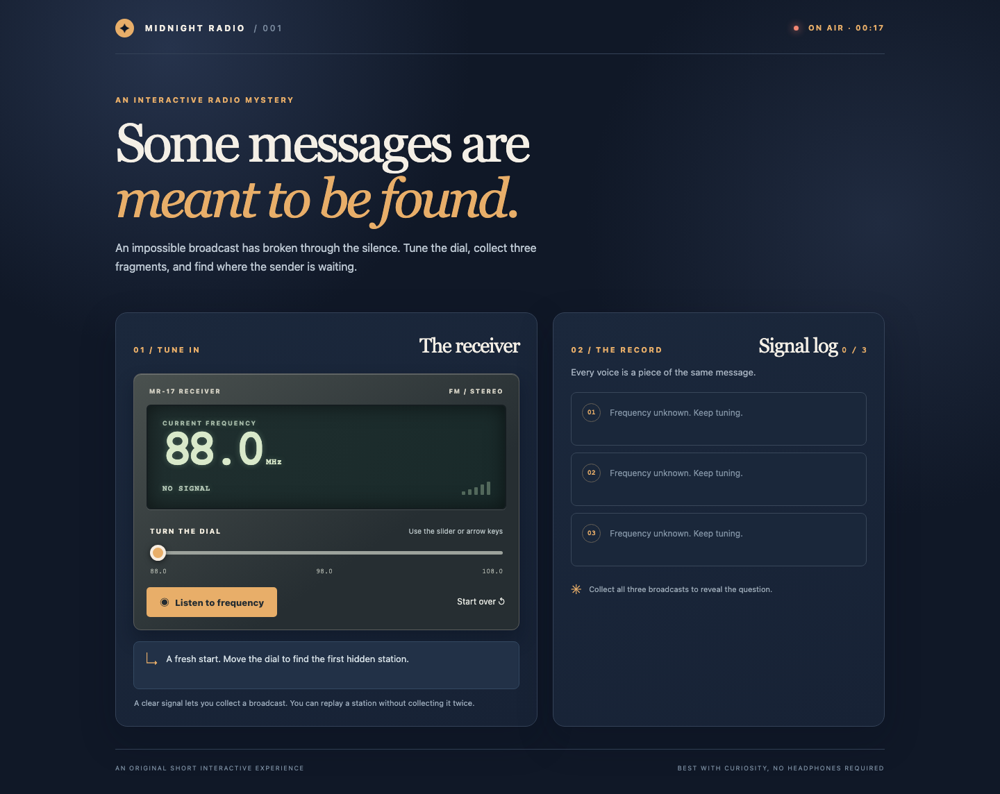

# Midnight Radio

**A short interactive radio mystery.** The player tunes an old receiver, finds three broadcasts, and uses their clues to decide where a mysterious sender is waiting. It is designed for someone who enjoys a two or three minute story puzzle. The aim is to make each action have a visible consequence: the dial changes signal strength, listening records a clue, and the final choice changes the ending.



## Play locally

This is a browser project with no dependencies, accounts, API keys, or external services. From a fresh terminal:

```sh
git clone https://github.com/JingyiChen888/midnight-radio.git
cd midnight-radio
python3 -m http.server 8000
```

Open <http://localhost:8000> in a browser. Stop the server with `Ctrl+C`. A recent version of Chrome, Safari, Firefox, or Edge should work. The game can also be opened directly as `index.html`, but the local server is the reproducible method used for testing.

## How to play

1. Move the frequency slider. The text signal meter and bars tell you when you are near a station. The slider also works with the keyboard arrow keys.
2. When the display says **CLEAR SIGNAL**, choose **Listen to frequency** to save the broadcast in the signal log.
3. Find all three broadcasts. Read them, answer the unlocked question, and choose **Start over** or **Play again** to reset.

The radio covers 88.0–108.0 MHz. A click on **Listen to frequency** with no clear signal explains what to do next. Listening twice to the same station does not add a second clue. A wrong final answer gives a specific hint and allows another choice.

## Project files

| File | Purpose |
| --- | --- |
| `index.html` | Page structure, controls, clues, and final question |
| `style.css` | Responsive visual design and signal meter |
| `app.js` | Frequency rules, state, feedback, puzzle, and reset |
| `assets/screenshot.png` | Screenshot of the initial interface |
| `PROCESS.md` | Design decisions, AI use, testing, and user trial record |

## Limitations

The radio is intentionally text based: it does not play audio, require permission, or save progress between visits. The mystery has one correct ending. These limits keep the main interaction easy to run and explain without external dependencies.

## Credits

Story, interface, and source code were created for this project with assistance from OpenAI Codex. No third-party images, audio, datasets, or course-example code are used. The radio visual is built with CSS and standard text symbols.
